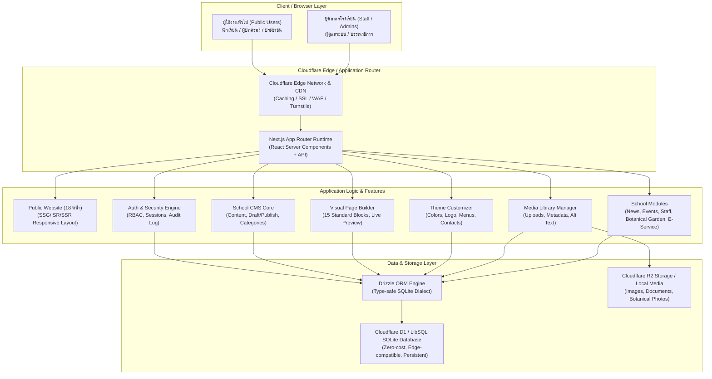

# สถาปัตยกรรมระบบ (System Architecture)
## โครงการ BNW-001 V2: โรงเรียนวัดบางน้ำวน (รอดพิทยาคม)

---

### 1. ภาพรวมสถาปัตยกรรม (High-Level Architecture)

โครงการ BNW-001 V2 เลือกใช้สถาปัตยกรรม **Unified Full-Stack Application** โดยรวมเว็บไซต์สาธารณะและระบบบริหารจัดการ (CMS + Page Builder + Media Library + School Modules) ไว้ใน Codebase เดียวกันเพื่อขจัดปัญหาความไม่สอดคล้องระหว่าง CMS และ Frontend ที่เคยเกิดขึ้นในเวอร์ชัน V1

---

### 2. การตัดสินใจเลือกเทคโนโลยี (Technology Stack)

| ส่วนของระบบ | เทคโนโลยีที่เลือก | เหตุผลความเหมาะสม |
|---|---|---|
| **Framework** | Next.js 15 (App Router) + TypeScript | รองรับทั้ง Server Components สำหรับหน้าเว็บที่โหลดรวดเร็ว และ Client Components สำหรับ Visual Page Builder พร้อม Type Safety สมบูรณ์แบบ |
| **Styling & UI** | Tailwind CSS + Lucide React | ยืดหยุ่น โค้ดมีขนาดเล็ก กำหนด Design Tokens สำหรับสีประจำโรงเรียน (น้ำเงิน-ทอง) ได้อย่างแม่นยำ |
| **Database ORM** | Drizzle ORM (SQLite Dialect) | ประสิทธิภาพสูงมาก ไม่มี overhead ของ query engine ทำงานเข้ากับ SQLite ได้ตรงไปตรงมา และเข้ากันได้ 100% กับ Cloudflare D1 |
| **Database Engine** | Cloudflare D1 (Production) / LibSQL (Dev & Test) | ฐานข้อมูลแบบ Serverless SQLite ที่ประจำอยู่บน Edge รวดเร็ว ไม่มีค่าใช้จ่ายในโควตาฟรี ไม่ต้องเปิดเซิร์ฟเวอร์ฐานข้อมูลภายนอก |
| **Storage Layer** | Cloudflare R2 / Local Disk Fallback | เข้ากันได้กับ S3 API ไม่มีค่าธรรมเนียม egress bandwidth (ฟรีโควตา 10 GB) สำหรับเก็บรูปภาพและเอกสาร |
| **Authentication** | Web Crypto + Jose + Bcrypt | เข้ารหัสผ่านอย่างปลอดภัย ใช้ Secure HTTP-Only Cookie Session ทำงานได้ทั้งบน Node.js และ Edge Runtime |

---

### 3. สถาปัตยกรรม Visual Page Builder

ระบบ Page Builder ทำงานตามหลักการ **Structured Block Components Pattern**:

1. **Schema Definition (`src/types/page-builder.ts`):** กำหนดโครงสร้างข้อมูล JSON สำหรับบล็อกทั้ง 15 ประเภท เช่น HeroBanner, TextSection, ImageGallery, StaffCards, BotanicalHighlight ฯลฯ
2. **Editor Canvas (`src/components/page-builder/editor/`):** รองรับการเพิ่ม ลบ สลับลำดับบล็อก ปรับแต่งคุณสมบัติ (Props Inspector) และดูตัวอย่างแบบเรียลไทม์ (Live Preview)
3. **Identical Block Renderer (`src/components/page-builder/renderer/`):** เป็น Component กลางที่ถูกเรียกใช้ทั้งในโหมดแก้ไข (Editor Preview) และในหน้าเว็บไซต์จริง (Public Page) ทำให้รับประกันว่าสิ่งที่ครูเห็นในหน้าจอจัดการจะตรงกับหน้าเว็บจริง 100%
4. **Persistence:** จัดเก็บข้อมูลโครงสร้างบล็อกในรูปแบบ JSON ลงฟิลด์ `content` ในตาราง `pages` ของฐานข้อมูล D1/SQLite

---

### 4. สถาปัตยกรรมความปลอดภัยและการควบคุมสิทธิ์ (Security & RBAC)

1. **ลำดับขั้นของบทบาท (Role Hierarchy):**
   - `super_admin`: ผู้ดูแลระบบสูงสุด (จัดการผู้ใช้, สิทธิ์, Theme, การสำรองข้อมูล)
   - `site_admin`: ผู้ดูแลเว็บไซต์ (จัดการเนื้อหาทั้งหมด, Page Builder, เมนู)
   - `editor`: บรรณาธิการ (ตรวจทานและเผยแพร่เนื้อหา, จัดการข่าว/ประกาศ/กิจกรรม)
   - `author`: ผู้เขียนเนื้อหา (สร้างและแก้ไขเนื้อหาของตนเอง บันทึกเป็นแบบร่างได้ แต่ไม่มีสิทธิ์เผยแพร่โดยตรง)
2. **Server-Side Enforcement:** ตรวจสอบสิทธิ์ทุกครั้งในระดับ API Routes และ Server Actions ไม่พึ่งพาเพียงการซ่อนปุ่มบน UI
3. **Audit Logging:** ทุกการกระทำสำคัญ เช่น การเข้าสู่ระบบ การเผยแพร่เนื้อหา การแก้ไขสิทธิ์ และการลบข้อมูล จะถูกบันทึกในตาราง `audit_logs` เสมอ
